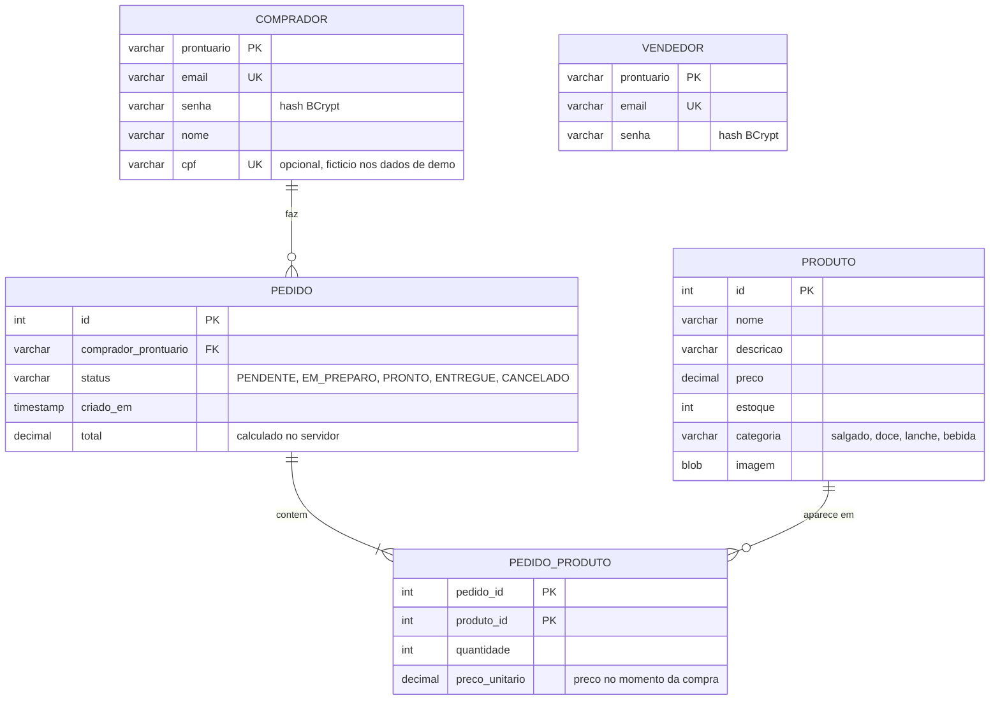

# CantinaIF

[](https://github.com/TiagoJSaraiva/CantinaIF/actions/workflows/ci.yml)

> Read in English: [README.md](README.md)

Sistema de pedidos antecipados para a cantina de um campus do IFSP (Instituto Federal de São Paulo): o aluno consulta os produtos do dia pelo celular, reserva itens antes do intervalo e retira (e paga) no balcão; o responsável pela cantina gerencia produtos, estoque e pedidos.

Demo online: _aguardando publicação_ <!-- DEMO_URL -->


## Sumário

1. [Visão geral](#visão-geral)
2. [Funcionalidades](#funcionalidades)
3. [Contas de demonstração](#contas-de-demonstração)
4. [Capturas de tela](#capturas-de-tela)
5. [Stack e arquitetura](#stack-e-arquitetura)
6. [Modelo de dados](#modelo-de-dados)
7. [Pré-requisitos](#pré-requisitos)
8. [Como rodar](#como-rodar)
9. [Variáveis de ambiente](#variáveis-de-ambiente)
10. [Dados de demonstração](#dados-de-demonstração)
11. [Testes e CI](#testes-e-ci)
12. [Implantação no Render](#implantação-no-render)
13. [Segurança](#segurança)
14. [Detalhes de implementação e limitações conhecidas](#detalhes-de-implementação-e-limitações-conhecidas)
15. [Créditos](#créditos)

## Visão geral

O CantinaIF nasceu como projeto final da disciplina *CJOWEB2* (IFSP, campus Campos do Jordão, 2025). As cantinas dos institutos federais ficam congestionadas nos intervalos; com o CantinaIF o aluno reserva o pedido durante a aula e o vendedor começa a preparar antes. **Não** é um sistema de delivery e **não há pagamento online**: o pagamento é feito no balcão, na retirada.

O projeto foi depois modernizado (segurança, domínio de pedidos, dados de demonstração, interface responsiva, Docker, CI) mantendo as escolhas tecnológicas originais: Servlets/JSP puros, JDBC, JavaScript vanilla, sem frameworks.

## Funcionalidades

**Aluno (comprador)**
- Cadastro com prontuário, nome, e-mail e senha; login e logout.
- Vitrine com busca por texto e filtro por categoria (salgados, lanches, doces, bebidas). Produtos esgotados aparecem, mas não podem ser comprados; selo "Última unidade" quando o estoque é 1.
- Carrinho com alteração de quantidade, remoção de itens, subtotal e total; o estoque é conferido considerando o que já está no carrinho.
- Finalizar pedido cria o pedido e baixa o estoque na mesma transação do banco. Se algum item não tiver estoque, nada é gravado e o aluno é avisado de qual item faltou.
- "Meus pedidos": histórico com status, itens, preço unitário da época da compra e total.
- Cancelamento enquanto o pedido está *Pendente* (o estoque volta).

**Vendedor (responsável pela cantina)**
- Painel de pedidos agrupado/filtrável por status (em andamento, pendentes, em preparo, prontos, entregues, cancelados), com contagens e atualização periódica.
- Ações explícitas de status: *Pendente → Em preparo → Pronto → Entregue*; cancelamento a partir de qualquer status não final (devolve o estoque). Transições inválidas são recusadas pelo servidor.
- Gestão de produtos: criar, editar (nome, descrição, preço, categoria, imagem), ajuste rápido de estoque, busca e filtro por categoria.
- Upload de imagem (JPEG, PNG, GIF ou WebP, até 2 MB) validado no servidor.

## Contas de demonstração

São contas fictícias de demonstração, não são segredos. Existem no modo demonstração (banco H2 embutido) e aparecem na tela de login.

| Perfil | Prontuário | Senha |
|--------|------------|-------|
| Aluno | `CJ3000001` | `demo1234` |
| Vendedor | `VEND001` | `demo1234` |

## Capturas de tela

| Login | Vitrine |
|---|---|
|  |  |
| **Carrinho** | **Meus pedidos** |
|  |  |
| **Vendedor: pedidos** | **Vendedor: produtos** |
|  |  |

As imagens foram capturadas da aplicação em execução (modo demonstração) num Chrome headless com 1280 px de largura.

## Stack e arquitetura

- **Java 21**, **Jakarta Servlet 6 / JSP + JSTL 3**, empacotamento WAR, Tomcat 10.1+ (testado no 10.1.28).
- **JDBC** (sem ORM) com pool **HikariCP**, configurado somente por variáveis de ambiente.
- **H2** (em memória, modo MySQL) por padrão; **MySQL 8** quando `CANTINA_DB_URL` está definida. Um único `db/schema.sql` serve aos dois.
- **BCrypt** (`at.favre.lib:bcrypt`) para senhas, **Gson** para JSON, **JUnit 5** para testes, **Maven Wrapper** (Maven 3.9.11).
- Front-end: páginas JSP + JavaScript vanilla (`fetch`) + um único CSS, mobile-first, sem frameworks.

```
db/schema.sql                 schema do banco (MySQL 8 e H2)
src/main/java/
  dao/                        acesso a dados via JDBC (usuários, produtos, pedidos) e exceções de regra de negócio
  model/                      objetos de domínio, DTOs de JSON, enum de status do pedido
  seed/DemoDataSeeder.java    dados de demonstração determinísticos (boot em H2, comando manual nos demais)
  servlets/                   controladores, endpoints JSON e filtros (veja abaixo)
  utils/                      Database (pool), configuração, BCrypt, limite de login, reset da demo, detecção de imagem
src/main/resources/seed/img/  ilustrações dos produtos de demonstração (PNG)
src/main/webapp/              páginas JSP, WEB-INF/jspf (head/navbar), css/app.css, js/, img/
src/test/java/                testes JUnit 5 (rodam em H2)
tools/GerarImagensSeed.java   gera as ilustrações da demo (Java2D)
docs/screenshots/             capturas de tela do README
Dockerfile, docker-compose.yml, render.yaml, .env.example, .github/workflows/ci.yml
```

Fluxo de uma requisição: `SecurityHeadersFilter` (CSP e demais cabeçalhos) → `AuthFilter` (controle de acesso por perfil: rotas do vendedor e do comprador) → `CsrfFilter` (token em toda requisição que altera estado) → servlet → DAO → pool do `Database`. As regras de negócio (estoque, transições de status) ficam no `PedidoDAO`, dentro de transações. Os endpoints JSON devolvem DTOs (nunca entidades brutas nem bytes de imagem).

## Modelo de dados



`VENDEDOR` é independente (há uma única cantina). Dinheiro é `DECIMAL(10,2)` no banco e `BigDecimal` no código. Restrições CHECK garantem preço/estoque/total não negativos, quantidade ≥ 1, a lista de categorias e a lista de status.

## Pré-requisitos

- JDK 21 (`JAVA_HOME` configurado).
- Para rodar o WAR sem Docker: Tomcat 10.1+ (namespace Jakarta; Tomcat 9 não funciona).
- Opcional: Docker (imagem e `docker compose`), MySQL 8.
- Maven não é necessário: use o wrapper incluído (`./mvnw`, ou `mvnw.cmd` no Windows).

## Como rodar

### Modo demonstração (sem banco)

```bash
./mvnw clean package
# copie target/CantinaIF-0.0.1-SNAPSHOT.war para webapps/ do Tomcat (como CantinaIF.war para /CantinaIF, ou ROOT.war para /)
```

Inicie o Tomcat e abra `http://localhost:8080/CantinaIF/` (ou `/`). Sem `CANTINA_DB_URL`, a aplicação usa um H2 em memória, cria o schema e carrega os dados de demonstração no boot. O context path é dinâmico: todas as URLs das páginas são relativas.

### Docker

```bash
docker build -t cantinaif .
docker run --rm -p 8080:8080 cantinaif
```

A imagem publica o app em `/` (`ROOT.war`), respeita a variável `PORT`, roda com usuário não-root e limita o heap com `-XX:MaxRAMPercentage`. Veja as [limitações](#detalhes-de-implementação-e-limitações-conhecidas): o Dockerfile ainda não foi executado.

### Com MySQL (`docker compose`)

```bash
cp .env.example .env     # defina MYSQL_PASSWORD (obrigatória)
docker compose up --build
```

O compose sobe o MySQL 8.4 (schema aplicado a partir de `db/schema.sql` na primeira inicialização, dados em volume nomeado) e o app, com `CANTINA_SEED_IF_EMPTY=true`, de modo que os dados de demonstração só são carregados se o banco ainda não tiver vendedor.

### Com um MySQL existente

Crie o banco (`CREATE DATABASE cantinaif CHARACTER SET utf8mb4 COLLATE utf8mb4_unicode_ci;`), aplique `db/schema.sql` e defina `CANTINA_DB_URL`, `CANTINA_DB_USER` e `CANTINA_DB_PASSWORD` para o Tomcat.

## Variáveis de ambiente

| Variável | Padrão | Finalidade |
|---|---|---|
| `CANTINA_DB_URL` | _(não definida)_ | URL JDBC. Sem ela, usa H2 embutido em modo demonstração. |
| `CANTINA_DB_USER` / `CANTINA_DB_PASSWORD` | _(não definidas)_ | Credenciais do banco (desnecessárias para H2). |
| `CANTINA_SEED_IF_EMPTY` | `false` | `true` carrega os dados de demonstração no boot se não houver vendedor (qualquer banco; não apaga nada). |
| `CANTINA_DEMO_RESET_HOURS` | `6` | Só no modo demonstração: horas entre restaurações automáticas do seed (aceita fração; `0` desliga). |
| `CANTINA_SEED_CONFIRMAR` | _(não definida)_ | `SIM` confirma o comando manual de seed (alternativa a `--confirmar-apagar`). |
| `CANTINA_COOKIE_SECURE` | `false` | `true` marca o cookie de sessão como `Secure` (use atrás de HTTPS). |
| `CANTINA_BEHIND_PROXY` | `false` | Imagem Docker: `true` faz o Tomcat confiar em `X-Forwarded-For`/`X-Forwarded-Proto` de proxies confiáveis. |
| `CANTINA_TRUSTED_PROXIES` | faixas privadas | Imagem Docker: regex Java dos IPs de proxy confiáveis. |
| `PORT` | `8080` | Imagem Docker: porta HTTP. |
| `MYSQL_DATABASE`, `MYSQL_USER`, `MYSQL_PASSWORD` | `cantinaif`, `cantina`, _(obrigatória)_ | Somente `docker compose`. |

As variáveis também podem ser passadas como propriedades de sistema da JVM com o mesmo nome (ex.: `-DCANTINA_DEMO_RESET_HOURS=1`). Nenhuma credencial fica no código nem no `context.xml`.

## Dados de demonstração

No modo demonstração a aplicação já nasce populada, para sempre haver o que mostrar. O seeder (`seed.DemoDataSeeder`) é determinístico (semente fixa `20260610`) e todas as datas são relativas ao momento da execução, então os dados nunca parecem velhos.

Conteúdo:
- **30 produtos** (8 salgados, 8 lanches, 7 doces, 7 bebidas) com nomes, descrições e preços realistas em reais. Casos extremos: 3 produtos esgotados, 1 com estoque 1, 1 com nome muito longo, 1 sem imagem.
- **Ilustrações originais** para 29 produtos (PNG, até 30 KB cada, versionadas em `src/main/resources/seed/img/`). Sem fotos nem arte de terceiros; marcas registradas foram evitadas.
- **1 vendedor e 19 alunos** (o aluno de demonstração, 15 com pedidos e 3 sem nenhum). Os nomes são fictícios, os e-mails usam o domínio `.demo` e os CPFs são gerados (dígitos verificadores válidos, não pertencem a pessoas reais).
- **50 pedidos** nos últimos 30 dias, em todos os status, com totais consistentes com os preços unitários; o aluno de demonstração tem um histórico variado.

Todos os dados são fictícios.

Como é restaurado:
- a cada reinício da aplicação (o H2 é em memória);
- periodicamente, a cada `CANTINA_DEMO_RESET_HOURS` horas (padrão 6);
- manualmente, no banco configurado (isto **apaga** produtos, compradores, vendedores e pedidos):

```bash
CANTINA_DB_URL=jdbc:mysql://localhost:3306/cantinaif CANTINA_DB_USER=... CANTINA_DB_PASSWORD=... \
  ./mvnw -q compile exec:java -Dexec.args=--confirmar-apagar
```

Sem `--confirmar-apagar` (ou `CANTINA_SEED_CONFIRMAR=SIM`) o comando só imprime um aviso e não faz nada; sem `CANTINA_DB_URL` ele se recusa a rodar.

Para regenerar as imagens (JDK 21, a partir da raiz do repositório):

```bash
java tools/GerarImagensSeed.java src/main/resources/seed/img
```

## Testes e CI

```bash
./mvnw verify
```

46 testes JUnit 5 rodam em H2 em memória: DAOs (usuários, vendedores, produtos, pedidos), BCrypt, domínio de pedidos (total calculado no servidor, baixa de estoque, estoque insuficiente com rollback, cancelamento devolvendo estoque, transições de status inválidas), seed (rodar duas vezes gera dados idênticos; totais e estoque consistentes), limitador de login, detecção do tipo de imagem e validação do cadastro.

O GitHub Actions (`.github/workflows/ci.yml`) executa `./mvnw -B verify` com JDK 21 a cada push e pull request na `main` e guarda o WAR como artefato. Não há testes automatizados de navegador.

## Implantação no Render

O repositório inclui um Blueprint do Render (`render.yaml`): um web service Docker chamado `cantinaif`, plano `free`, health check em `/health` (pública, leve, sem login e sem banco), deploy automático ligado e as variáveis `CANTINA_COOKIE_SECURE=true`, `CANTINA_DEMO_RESET_HOURS=6` e `CANTINA_BEHIND_PROXY=true`. `CANTINA_DB_URL` fica propositalmente sem definir, então o app roda em modo demonstração com H2.

1. Crie uma conta em [render.com](https://render.com) e conecte sua conta do GitHub.
2. **New → Blueprint**, escolha este repositório e confirme. O Render constrói o Dockerfile e publica.
3. Quando o deploy terminar, abra a URL do serviço e entre com as contas de demonstração.
4. Coloque o endereço público na linha "Demo online" no topo deste arquivo.

Avisos honestos do plano gratuito:
- o serviço **hiberna após cerca de 15 minutos sem tráfego** e leva **cerca de 1 minuto** para acordar na próxima requisição;
- o sistema de arquivos é **efêmero** e o banco é em memória, então os **dados voltam ao seed a cada reinício** (e a cada 6 horas enquanto está no ar);
- a instância gratuita é pequena (512 MB); a imagem limita o heap do Java de acordo.

Atrás do proxy HTTPS do Render: o `RemoteIpValve` do Tomcat está na imagem e só confia nos cabeçalhos `X-Forwarded-*` quando `CANTINA_BEHIND_PROXY=true` e a conexão vem de um endereço de proxy confiável (privado). Com isso o cookie de sessão fica `Secure` e o limitador de login usa o IP real do cliente. Isso foi verificado localmente simulando os cabeçalhos com `curl`; não foi verificado no próprio Render.

## Segurança

- Senhas guardadas como hash BCrypt; a sessão nunca guarda senha; o id da sessão é trocado no login; o logout invalida a sessão (POST + CSRF).
- Controle de acesso por perfil no `AuthFilter` para páginas e APIs (vendedor × comprador), 401/403 nas APIs e redirecionamento ao login nas páginas.
- CSRF: token por sessão exigido em todo POST/PUT/DELETE (cabeçalho `X-CSRF-Token` ou campo `_csrf`).
- Cabeçalhos: Content-Security-Policy estrita (sem scripts nem estilos inline), `X-Frame-Options: DENY`, `X-Content-Type-Options: nosniff`, `Referrer-Policy`, `Permissions-Policy`, HSTS em HTTPS.
- Cookie de sessão `HttpOnly` e `SameSite=Lax`, `Secure` quando configurado ou quando a requisição é HTTPS.
- Limite de login: 8 tentativas falhas a cada 5 minutos por IP de cliente (em memória, por instância).
- Uploads: limite de tamanho (2 MB), tipo real detectado pelos bytes iniciais (JPEG/PNG/GIF/WebP), servido com o tipo detectado e `nosniff`.
- Escape de saída em toda parte (`<c:out>`, `textContent`); `PreparedStatement` em todo o SQL; páginas de erro amigáveis, sem stack trace.

## Detalhes de implementação e limitações conhecidas

- Não há pagamento online: o pedido é reservado e pago no balcão.
- O estoque é baixado na criação do pedido e devolvido no cancelamento (`UPDATE ... WHERE estoque >= ?` atômico dentro da transação do pedido).
- O formulário de cadastro pede prontuário, nome, e-mail e senha. A coluna CPF existe, mas só é preenchida pelos dados de demonstração. A ideia original de validar prontuários na base da instituição e de suportar vários campi/cantinas **não está implementada**: há uma única cantina.
- A imagem Docker e o `docker compose` **não foram executados** (o Docker estava indisponível durante o desenvolvimento); foram verificados apenas `docker compose config`, a sintaxe do entrypoint e a substituição de propriedades do Tomcat usada pela imagem.
- O seed foi testado somente em H2. O caminho do MySQL (reinício do `AUTO_INCREMENT`) não foi exercitado.
- Bancos criados com o schema antigo precisam de `ALTER TABLE`: adicionar `Comprador.cpf VARCHAR(11) UNIQUE`; adicionar `Pedido.status VARCHAR(12) NOT NULL DEFAULT 'PENDENTE'`, `Pedido.criado_em TIMESTAMP NOT NULL DEFAULT CURRENT_TIMESTAMP` e `Pedido.total DECIMAL(10,2) NOT NULL DEFAULT 0`; adicionar `Pedido_Produto.preco_unitario DECIMAL(10,2) NOT NULL DEFAULT 0`. Senhas antigas em texto puro não são hashes BCrypt válidos, então esses usuários precisam ser recriados.
- O carrinho fica na sessão HTTP (em memória); o limitador de login é por instância; as imagens são guardadas como BLOB; as listas não têm paginação; o painel do vendedor atualiza por polling.
- As datas são exibidas no fuso horário do navegador.

## Créditos

Projeto final da disciplina CJOWEB2, IFSP Campos do Jordão, 2025, por:

- Brian Gustavo de Oliveira Brandão
- Luiz Henrique Freitas
- Tiago Jarruge Saraiva
- Arthur de Almeida Brandino
