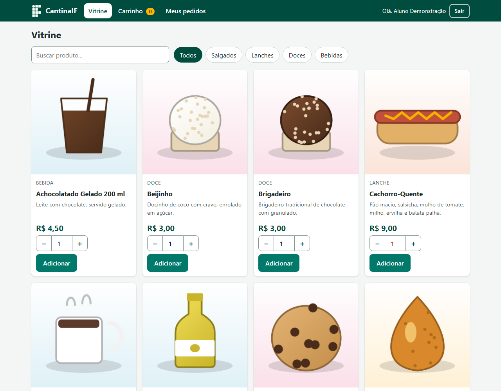
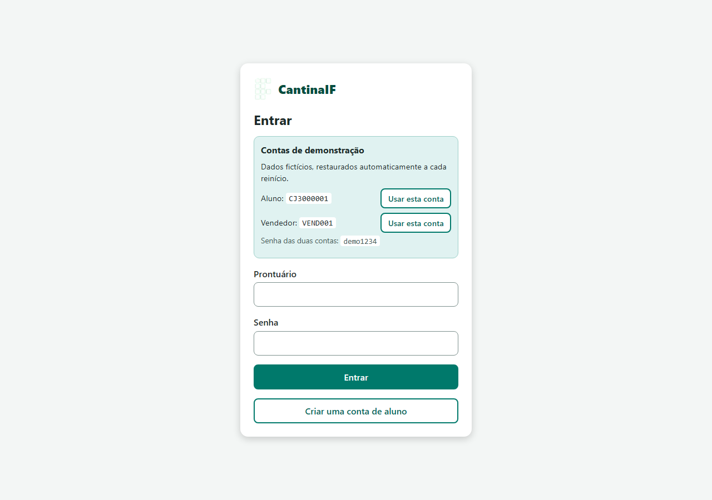
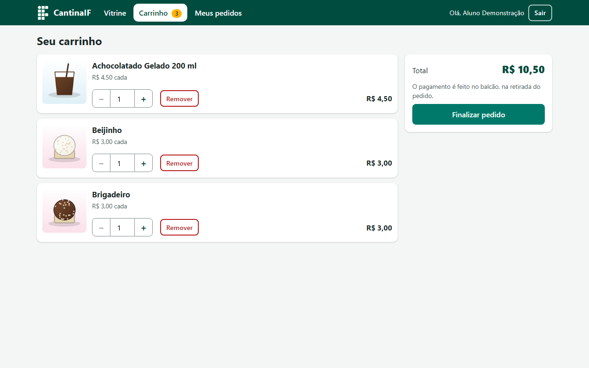
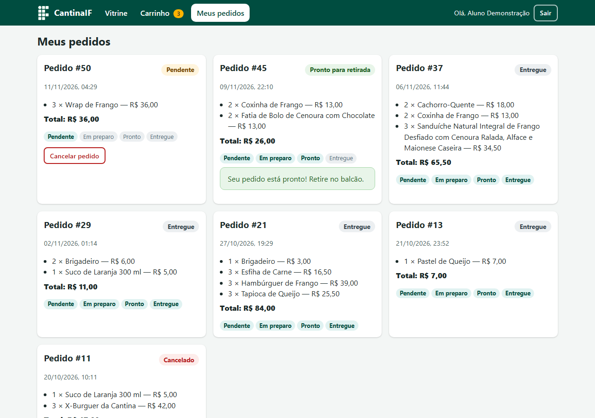
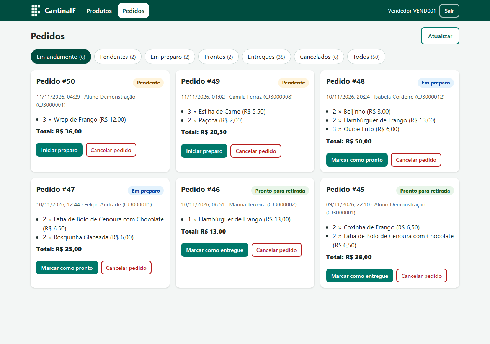
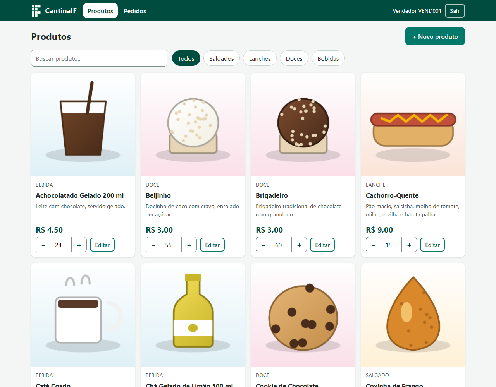
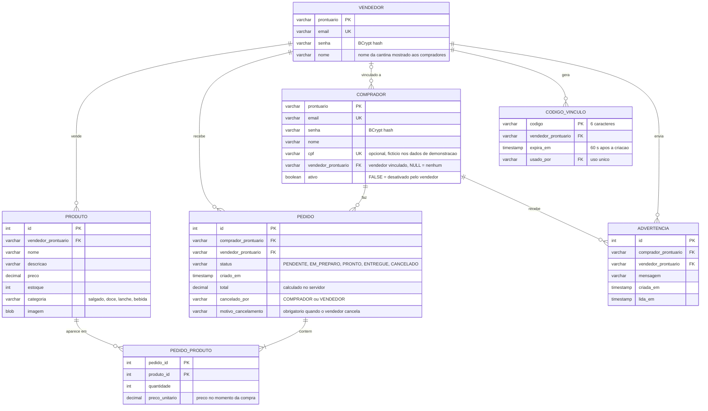

# CantinaIF

[](https://github.com/TiagoJSaraiva/CantinaIF/actions/workflows/ci.yml)

> Read in English: [README.md](README.md)

Sistema de pedidos antecipados para a cantina de um campus do IFSP (Instituto Federal de São Paulo): o aluno consulta os produtos do dia pelo celular, reserva itens antes do intervalo e retira (e paga) no balcão; o responsável pela cantina gerencia produtos, estoque e pedidos.

Demo online: **https://cantinaif-ubt0.onrender.com** (instância gratuita do Render: o primeiro acesso depois de 15 minutos sem uso pode levar cerca de um minuto)



## Sumário

1. [Visão geral](#visão-geral)
2. [Funcionalidades](#funcionalidades)
3. [Contas de demonstração](#contas-de-demonstração)
4. [Capturas de tela](#capturas-de-tela)
5. [Stack e arquitetura](#stack-e-arquitetura)
6. [Modelo de dados](#modelo-de-dados)
7. [Pré-requisitos](#pré-requisitos)
8. [Como rodar](#como-rodar)
9. [Variáveis de ambiente](#variáveis-de-ambiente)
10. [Dados de demonstração](#dados-de-demonstração)
11. [Testes e CI](#testes-e-ci)
12. [Implantação no Render](#implantação-no-render)
13. [Segurança](#segurança)
14. [Detalhes de implementação e limitações conhecidas](#detalhes-de-implementação-e-limitações-conhecidas)
15. [Créditos](#créditos)

## Visão geral

O CantinaIF nasceu como projeto final da disciplina *CJOWEB2* (IFSP, campus Campos do Jordão, 2025). As cantinas dos institutos federais ficam congestionadas nos intervalos; com o CantinaIF o aluno reserva o pedido durante a aula e o vendedor começa a preparar antes. **Não** é um sistema de delivery e **não há pagamento online**: o pagamento é feito no balcão, na retirada.

O projeto foi depois modernizado (segurança, domínio de pedidos, dados de demonstração, interface responsiva, Docker, CI) mantendo as escolhas tecnológicas originais: Servlets/JSP puros, JDBC, JavaScript vanilla, sem frameworks.

## Funcionalidades

**Aluno (comprador)**
- Cadastro com prontuário, nome, e-mail e senha; login e logout.
- **Vínculo com uma cantina por código do vendedor.** O vendedor gera um código de 6 caracteres que vale por 1 minuto e para um único aluno. O aluno digita o código no cadastro (opcional) ou depois, em "Minha conta"; até lá o catálogo não mostra produtos, só o formulário do código. Cada conta fica vinculada a uma cantina por vez; um código novo troca de cantina (o carrinho é esvaziado e os pedidos antigos continuam no histórico).
- Advertências enviadas pelo vendedor aparecem num popup no catálogo, num contador no menu e numa lista em "Minha conta" (marcar como lidas). Uma conta desativada ainda entra, mas só vê o aviso e as advertências: sem produtos, carrinho, pedidos nem troca de cantina, inclusive em sessões que já estavam abertas.
- Pedidos cancelados pela cantina mostram o motivo informado pelo vendedor.
- Catálogo com busca por texto e filtro por categoria (salgados, lanches, doces, bebidas). Produtos esgotados aparecem, mas não podem ser comprados; selo "Última unidade" quando o estoque é 1.
- Carrinho com alteração de quantidade, remoção de itens, subtotal e total (até 99 unidades por item); o estoque é conferido considerando o que já está no carrinho.
- Finalizar pedido cria o pedido e baixa o estoque na mesma transação do banco. Se algum item não tiver estoque, nada é gravado e o aluno é avisado de qual item faltou. Se o preço mudou desde que o item entrou no carrinho, também não se grava nada: o carrinho é atualizado e o aluno precisa confirmar de novo.
- "Meus pedidos": histórico com status, itens, preço unitário da época da compra e total.
- Cancelamento enquanto o pedido está *Pendente* (o estoque volta).

**Vendedor (responsável pela cantina)**
- Qualquer pessoa pode criar uma conta de vendedor (cadastro, "Sou vendedor", com o nome da cantina). Cada vendedor só vê e altera os próprios produtos, pedidos e compradores.
- Página "Compradores": geração de códigos de vínculo (contagem regressiva de 60 s, uso único, gerar outro invalida o anterior não usado) e tabela dos alunos vinculados (pedidos, cancelamentos feitos pelo aluno e pelo vendedor, último pedido, advertências, situação) com busca e filtro. Ações: **enviar advertência** (mensagens prontas, como "Cancelamentos estão ocorrendo com frequência. Se continuar, você poderá ser multado.", ou texto livre de até 500 caracteres) e **desativar/reativar** o aluno.
- Cancelar um pedido exige um motivo (3 a 300 caracteres, com motivos comuns prontos); o aluno vê o motivo.
- Painel de pedidos agrupado/filtrável por status (em andamento, pendentes, em preparo, prontos, entregues, cancelados), com contagens e atualização periódica.
- Ações explícitas de status: *Pendente → Em preparo → Pronto → Entregue*; cancelamento a partir de qualquer status não final (devolve o estoque). Transições inválidas são recusadas pelo servidor.
- Gestão de produtos: criar, editar (nome, descrição, preço, categoria, imagem), ajuste rápido de estoque, busca e filtro por categoria. A edição de estoque é "compara e troca" no SQL: se um pedido mudou o estoque nesse meio tempo, o painel informa o conflito (HTTP 409) em vez de sobrescrever.
- Upload de imagem (JPEG, PNG ou GIF, até 2 MB). Toda imagem é decodificada, redimensionada (lado maior de 640 px) e recomprimida em JPEG (até 150 KB, sem metadados) no servidor; arquivos que não decodificam são rejeitados. WebP não é suportado.

## Contas de demonstração

São contas fictícias de demonstração, não são segredos. Existem no modo demonstração (banco H2 embutido) e aparecem na tela de login.

| Perfil | Prontuário | Senha |
|--------|------------|-------|
| Aluno | `CJ3000001` | `demo1234` |
| Vendedor (Cantina Central) | `VEND001` | `demo1234` |
| Vendedor (Lanchonete do Bloco B) | `VEND002` | `demo1234` |

O aluno de demonstração está vinculado à Cantina Central. Para testar o vínculo, crie uma conta de aluno e use um código gerado por um dos vendedores na página "Compradores".

## A demo pública: o que esperar

Se houver uma demo pública publicada, tenha em mente (tudo isso é proposital, para manter uma demo gratuita e exposta à internet segura e barata):

- **Contas compartilhadas com senha pública.** Qualquer pessoa pode entrar como o aluno ou o vendedor de demonstração e criar, editar ou cancelar qualquer coisa. Não digite dados pessoais reais; tudo é fictício.
- **Limites** (padrões no modo demonstração, configuráveis, veja a tabela de variáveis): 300 produtos (40 por vendedor), 30 contas de vendedor, 200 cadastros de aluno, 50 advertências por aluno, 100 pedidos em aberto (e 5 por comprador), 12 MB de imagens no total. Ao atingir um limite o app avisa ("limite da demonstração atingido; a base é restaurada periodicamente"). Há também limite de taxa para operações de escrita, cadastros e logins.
- **Restauração periódica.** O banco é em memória e volta ao seed a cada reinício e a cada `CANTINA_DEMO_RESET_HOURS` horas (padrão 6). Tudo que os visitantes criarem desaparece.
- **Sessões na restauração.** Uma sessão iniciada antes da restauração é invalidada: o próximo clique leva ao login com a mensagem "A demonstração foi restaurada; entre novamente." (uma conta criada antes da restauração deixa de existir).
- **Uploads são recodificados.** Imagens com mais de cerca de 5 megapixels (lidos do cabeçalho do arquivo, antes de decodificar) são rejeitadas; as demais são decodificadas com subamostragem, reduzidas a no máximo 640 px e recomprimidas em JPEG de até 150 KB. Só uma imagem é processada por vez em toda a aplicação; uploads simultâneos esperam até 3 s e depois recebem 503 ("tente novamente em instantes"). Os limites da demo (produtos, bytes de imagem) são verificados antes de qualquer processamento.
- **Limites de tamanho de requisição.** Todo corpo de requisição é limitado: 16 KB para JSON e formulários e cerca de 2,1 MB para uploads de imagem (HTTP 413 acima disso, também para requisições chunked sem `Content-Length`), e o conector do Tomcat acrescenta limites próprios (`maxPostSize`, `maxSwallowSize`, `maxParameterCount`, tamanho de cabeçalho, tempos limite curtos, no máximo 60 threads).
- **Sessões.** Visitantes anônimos nunca ganham sessão: os formulários de login e cadastro usam um cookie CSRF de envio duplo (aleatório, `SameSite=Strict`). A sessão só nasce num login bem-sucedido (e o número de sessões ativas tem teto; ao atingi-lo a tela de login responde 503 com uma mensagem amigável em vez de erro).
- **A restauração nunca mostra um banco pela metade.** Ela espera as conexões abertas com o banco (até 10 s, depois tenta de novo 30 s mais tarde) e a trava só é mantida enquanto há conexões em uso, nunca durante uma requisição HTTP inteira; assim clientes lentos não congelam a aplicação e o `/health` não depende do banco.
- **Limite por comprador.** Um comprador pode ter no máximo 5 pedidos em aberto ao mesmo tempo no modo demo, e o carrinho só aceita quantidades inteiras (1,5 é rejeitado).
- **Riscos residuais, com honestidade.** É uma demo com vendedor público, restaurada periodicamente: um visitante mal-intencionado ainda pode bagunçar os dados (criar, editar ou cancelar qualquer coisa dentro dos limites acima) até a próxima restauração, pode consumir os limites de escrita do próprio IP e pode travar uma conta que não seja de demo por alguns minutos errando o login de propósito. Ataques de conexão lenta são apenas mitigados (tempos limite curtos, pool de threads limitado), não eliminados, e tudo é em memória e por instância. Não use esta configuração com dados reais.

## Capturas de tela

| Login | Catálogo |
|---|---|
|  |  |
| **Carrinho** | **Meus pedidos** |
|  |  |
| **Vendedor: pedidos** | **Vendedor: produtos** |
|  |  |

As imagens foram capturadas da aplicação em execução (modo demonstração) num Chrome headless com 1280 px de largura.

## Stack e arquitetura

- **Java 21**, **Jakarta Servlet 6 / JSP + JSTL 3**, empacotamento WAR, Tomcat 10.1+ (testado no 10.1.28).
- **JDBC** (sem ORM) com pool **HikariCP**, configurado somente por variáveis de ambiente.
- **H2** (em memória, modo MySQL) por padrão; **MySQL 8** quando `CANTINA_DB_URL` está definida. Um único `db/schema.sql` serve aos dois.
- **BCrypt** (`at.favre.lib:bcrypt`) para senhas, **Gson** para JSON, **JUnit 5** para testes, **Maven Wrapper** (Maven 3.9.11).
- Front-end: páginas JSP + JavaScript vanilla (`fetch`) + um único CSS, mobile-first, sem frameworks.

```
db/schema.sql                 schema do banco (MySQL 8 e H2)
db/migracao-002-multivendedor.sql  ALTER TABLEs para bancos MySQL criados antes do multivendedor
src/main/java/
  dao/                        acesso a dados via JDBC (usuários, produtos, pedidos) e exceções de regra de negócio
  model/                      objetos de domínio, DTOs de JSON, enum de status do pedido
  seed/DemoDataSeeder.java    dados de demonstração determinísticos (boot em H2, comando manual nos demais)
  servlets/                   controladores, endpoints JSON e filtros (veja abaixo)
  utils/                      Database (pool e trava da restauração), configuração, BCrypt, proteção de login e limitador de taxa, IP do cliente, tetos da demo, reset da demo, processamento de imagem
src/main/resources/seed/img/  fotos dos produtos de demonstração (JPEG, CC0/domínio público; créditos em CREDITOS.md)
src/main/webapp/              páginas JSP, WEB-INF/jspf (head/navbar), css/app.css, js/, img/
src/test/java/                testes JUnit 5 (rodam em H2)
docs/screenshots/             capturas de tela do README
Dockerfile, docker-compose.yml, render.yaml, .env.example, .github/workflows/ci.yml
```

Fluxo de uma requisição: `BodyLimitFilter` (limite de tamanho da requisição, 413) → `SecurityHeadersFilter` (CSP e demais cabeçalhos) → `WriteRateFilter` (limite de taxa das operações de escrita) → `AuthFilter` (controle de acesso por perfil: rotas do vendedor e do comprador; também descarta sessões de antes de uma restauração) → `CsrfFilter` (token em toda requisição que altera estado; cookie de envio duplo no login/cadastro anônimos) → servlet → DAO → pool do `Database`. A trava que mantém a restauração da demo atômica fica em `Database.getConnection()` (mantida só enquanto uma conexão está aberta); uma requisição cuja sessão é anterior a uma restauração é redirecionada ao login. As regras de negócio (estoque, transições de status) ficam no `PedidoDAO`, dentro de transações. Os endpoints JSON devolvem DTOs (nunca entidades brutas nem bytes de imagem).

## Modelo de dados



Cada vendedor é uma cantina: produtos e pedidos pertencem a um vendedor, e o comprador fica vinculado a no máximo um vendedor por vez (`Comprador.vendedor_prontuario`). Dinheiro é `DECIMAL(10,2)` no banco e `BigDecimal` no código. Restrições CHECK garantem preço/estoque/total não negativos, quantidade ≥ 1, a lista de categorias, a lista de status e quem cancelou o pedido.

## Pré-requisitos

- JDK 21 (`JAVA_HOME` configurado).
- Para rodar o WAR sem Docker: Tomcat 10.1+ (namespace Jakarta; Tomcat 9 não funciona).
- Opcional: Docker (imagem e `docker compose`), MySQL 8.
- Maven não é necessário: use o wrapper incluído (`./mvnw`, ou `mvnw.cmd` no Windows).

## Como rodar

### Modo demonstração (sem banco)

```bash
./mvnw clean package
# copie target/CantinaIF-0.0.1-SNAPSHOT.war para webapps/ do Tomcat (como CantinaIF.war para /CantinaIF, ou ROOT.war para /)
```

Inicie o Tomcat e abra `http://localhost:8080/CantinaIF/` (ou `/`). Sem `CANTINA_DB_URL`, a aplicação usa um H2 em memória, cria o schema e carrega os dados de demonstração no boot. O context path é dinâmico: todas as URLs das páginas são relativas.

### Docker

```bash
docker build -t cantinaif .
docker run --rm -p 8080:8080 cantinaif
```

A imagem publica o app em `/` (`ROOT.war`), respeita a variável `PORT`, roda com usuário não-root (`app`) e limita a memória (`-XX:MaxRAMPercentage=60`, `-XX:MaxMetaspaceSize=192m`, `-XX:+ExitOnOutOfMemoryError`, para a plataforma reiniciar o serviço se a memória acabar). A cada início o `docker-entrypoint.sh` edita o `conf/server.xml` do Tomcat de forma idempotente (porta, `ErrorReportValve` sem relatório/versão e, somente com `CANTINA_BEHIND_PROXY=true`, um `RemoteIpValve`); o regex de proxies nunca passa por `JAVA_OPTS`. A imagem foi construída e executada localmente (veja os [detalhes de implementação](#detalhes-de-implementação-e-limitações-conhecidas)) e um job do CI constrói a imagem e roda um teste de fumaça a cada push.

### Com MySQL (`docker compose`)

```bash
cp .env.example .env     # defina MYSQL_PASSWORD (obrigatória)
docker compose up --build
```

O compose sobe o MySQL 8.4 (schema aplicado a partir de `db/schema.sql` na primeira inicialização, dados em volume nomeado) e o app, com `CANTINA_SEED_IF_EMPTY=true`, de modo que os dados de demonstração só são carregados se o banco ainda não tiver vendedor.

### Com um MySQL existente

Crie o banco (`CREATE DATABASE cantinaif CHARACTER SET utf8mb4 COLLATE utf8mb4_unicode_ci;`), aplique `db/schema.sql` e defina `CANTINA_DB_URL`, `CANTINA_DB_USER` e `CANTINA_DB_PASSWORD` para o Tomcat.

## Variáveis de ambiente

| Variável | Padrão | Finalidade |
|---|---|---|
| `CANTINA_DB_URL` | _(não definida)_ | URL JDBC. Sem ela, usa H2 embutido em modo demonstração. |
| `CANTINA_DB_USER` / `CANTINA_DB_PASSWORD` | _(não definidas)_ | Credenciais do banco (desnecessárias para H2). |
| `CANTINA_SEED_IF_EMPTY` | `false` | `true` carrega os dados de demonstração no boot se não houver vendedor (qualquer banco; não apaga nada). |
| `CANTINA_DEMO_RESET_HOURS` | `6` | Só no modo demonstração: horas entre restaurações automáticas do seed (aceita fração; `0` desliga). |
| `CANTINA_SEED_CONFIRMAR` | _(não definida)_ | `SIM` confirma o comando manual de seed (alternativa a `--confirmar-apagar`). |
| `CANTINA_MAX_PRODUTOS` | `300` no modo demonstração, sem limite nos demais | Número máximo de produtos, somando todos os vendedores (`0` = sem limite). |
| `CANTINA_MAX_PRODUTOS_POR_VENDEDOR` | `40` no modo demonstração, sem limite nos demais | Número máximo de produtos por vendedor. |
| `CANTINA_MAX_VENDEDORES` | `30` no modo demonstração, sem limite nos demais | Número máximo de contas de vendedor. |
| `CANTINA_MAX_ADVERTENCIAS_POR_COMPRADOR` | `50` no modo demonstração, sem limite nos demais | Número máximo de advertências guardadas por aluno. |
| `CANTINA_MAX_COMPRADORES` | `200` no modo demonstração, sem limite nos demais | Número máximo de alunos cadastrados. |
| `CANTINA_MAX_PEDIDOS_ABERTOS` | `100` no modo demonstração, sem limite nos demais | Número máximo de pedidos em aberto (pendente, em preparo ou pronto). |
| `CANTINA_MAX_PEDIDOS_ABERTOS_POR_COMPRADOR` | `5` no modo demonstração, sem limite nos demais | Número máximo de pedidos em aberto por comprador. |
| `CANTINA_MAX_BYTES_IMAGENS` | `12582912` (12 MB) no modo demonstração, sem limite nos demais | Tamanho total máximo das imagens de produto guardadas. |
| `CANTINA_COOKIE_SECURE` | `false` | `true` marca o cookie de sessão como `Secure` (use atrás de HTTPS). |
| `CANTINA_BEHIND_PROXY` | `false` | `true` declara que o app está atrás de um proxy HTTPS confiável: o entrypoint do Docker adiciona o `RemoteIpValve` (aceita `X-Forwarded-For`/`X-Forwarded-Proto` de proxies confiáveis) e `CANTINA_CLIENT_IP_HEADER` passa a valer. |
| `CANTINA_TRUSTED_PROXIES` | faixas privadas | Imagem Docker: regex Java dos IPs de proxy confiáveis (só vale com `CANTINA_BEHIND_PROXY=true`). |
| `CANTINA_CLIENT_IP_HEADER` | _(não definida)_ | Opcional, só com `CANTINA_BEHIND_PROXY=true`: nome de um cabeçalho de IP do cliente definido pela borda (ex.: `True-Client-IP`). Sem ele, quem decide é o `RemoteIpValve` (`X-Forwarded-For` de proxies confiáveis). O log informa qual origem está em uso. |
| `PORT` | `8080` | Imagem Docker: porta HTTP. |
| `MYSQL_DATABASE`, `MYSQL_USER`, `MYSQL_PASSWORD` | `cantinaif`, `cantina`, _(obrigatória)_ | Somente `docker compose`. |

As variáveis também podem ser passadas como propriedades de sistema da JVM com o mesmo nome (ex.: `-DCANTINA_DEMO_RESET_HOURS=1`). Nenhuma credencial fica no código nem no `context.xml`.

## Dados de demonstração

No modo demonstração a aplicação já nasce populada, para sempre haver o que mostrar. O seeder (`seed.DemoDataSeeder`) é determinístico (semente fixa `20260610`) e todas as datas são relativas ao momento da execução, então os dados nunca parecem velhos.

Conteúdo:
- **36 produtos**: 30 da Cantina Central (8 salgados, 8 lanches, 7 doces, 7 bebidas) e 6 da Lanchonete do Bloco B, com nomes, descrições e preços realistas em reais. Casos extremos: 3 produtos esgotados, 1 com estoque 1, 1 com nome muito longo, 1 sem imagem.
- **Fotos reais** para 29 produtos (JPEG 480×360, até 40 KB cada, versionadas em `src/main/resources/seed/img/`; o seed as carrega como estão, sem a recodificação dos uploads). Vêm da Wikimedia Commons e do Openverse, todas com licença CC0 ou em domínio público e sem marca d'água; origem, autor e licença de cada uma estão em `src/main/resources/seed/img/CREDITOS.md`. Marcas registradas foram evitadas.
- **2 vendedores e 19 alunos** (o aluno de demonstração e outros 15 vinculados à Cantina Central, 2 vinculados à Lanchonete do Bloco B e 1 sem vínculo; um aluno da Cantina Central está desativado). Os nomes são fictícios e os e-mails usam o domínio `.demo`. Os CPFs são gerados sinteticamente (têm dígitos verificadores válidos, mas nenhuma relação com pessoas reais; qualquer coincidência com um número real é acidental). O CPF fica apenas numa coluna do banco e não é exibido em nenhuma tela nem retornado por nenhuma API.
- **Advertências**: o aluno desativado tem duas, um aluno que cancela muito tem uma, e o aluno de demonstração tem um lembrete não lido (para a faixa e o contador aparecerem).
- **53 pedidos** (50 da Cantina Central e 3 da Lanchonete do Bloco B) nos últimos 30 dias, em todos os status; os cancelados alternam entre cancelados pelo aluno e pela cantina (sempre com motivo), com totais consistentes com os preços unitários; o aluno de demonstração tem um histórico variado. O estoque segue a regra real (o pedido baixa o estoque ao ser criado, cancelar devolve): o estoque gravado é o final e o seeder calcula o inicial como final + unidades dos pedidos não cancelados, então nenhum pedido aberto excede o estoque inicial.

Todos os dados são fictícios.

Como é restaurado:
- a cada reinício da aplicação (o H2 é em memória);
- periodicamente, a cada `CANTINA_DEMO_RESET_HOURS` horas (padrão 6). A restauração é atômica: hashes e imagens são preparados antes, depois a trava é obtida com tempo limite (se as conexões continuarem abertas, tenta de novo 30 s depois) e tudo é apagado e reinserido em uma única transação; sessões de antes da restauração são invalidadas;
- manualmente, no banco configurado (isto **apaga** produtos, compradores, vendedores e pedidos):

```bash
CANTINA_DB_URL=jdbc:mysql://localhost:3306/cantinaif CANTINA_DB_USER=... CANTINA_DB_PASSWORD=... \
  ./mvnw -q compile exec:java -Dexec.args=--confirmar-apagar
```

Sem `--confirmar-apagar` (ou `CANTINA_SEED_CONFIRMAR=SIM`) o comando só imprime um aviso e não faz nada; sem `CANTINA_DB_URL` ele se recusa a rodar.

## Testes e CI

```bash
./mvnw verify
```

114 testes JUnit 5 rodam em H2 em memória (e Mockito para os filtros): DAOs (usuários, vendedores, produtos, pedidos), BCrypt, domínio de pedidos (total calculado no servidor, baixa de estoque, estoque insuficiente com rollback, mudança de preço no checkout, cancelamento devolvendo estoque, transições de status inválidas, edição de estoque por compara-e-troca), carrinho (estouro, concorrência, quantidades inteiras estritas), seed (rodar duas vezes gera dados idênticos; totais, estoque e estoque inicial consistentes; leitores e checkouts concorrentes durante restaurações repetidas nunca veem o banco vazio ou inconsistente), a trava do banco (tempos limite, geração da sessão, sem vazamento de trava), `BodyLimitFilter`, `AuthFilter`, `CsrfFilter` (inclusive milhares de requisições anônimas sem criar sessão), proteção de login (por conta e por IP), resolução do IP do cliente, limitador de taxa, tetos da demo, redimensionamento de imagem (bomba de pixels, concorrência) e detecção do tipo, e validação do cadastro.

O GitHub Actions (`.github/workflows/ci.yml`) tem dois jobs a cada push e pull request na `main`: `./mvnw -B verify` com JDK 21 (o WAR fica como artefato) e um job Docker que constrói a imagem, executa com `PORT=10000`, `CANTINA_BEHIND_PROXY=true` e limite de 512 MB e roda `tools/smoke-proxy.sh` (health check, cookie `Secure`, HSTS, IP real do cliente no limitador de login, página de erro sem detalhes do servidor) mais a verificação de usuário não-root. `tools/test-entrypoint.sh` executa o entrypoint de verdade contra uma cópia local do Tomcat 10.1 (sem Docker). Não há testes automatizados de navegador.

## Implantação no Render

O repositório inclui um Blueprint do Render (`render.yaml`): um web service Docker chamado `cantinaif`, plano `free`, health check em `/health` (pública, leve, sem login e sem banco), deploy automático ligado e as variáveis `CANTINA_COOKIE_SECURE=true`, `CANTINA_DEMO_RESET_HOURS=6` e `CANTINA_BEHIND_PROXY=true`. `CANTINA_DB_URL` fica propositalmente sem definir, então o app roda em modo demonstração com H2.

1. Crie uma conta em [render.com](https://render.com) e conecte sua conta do GitHub.
2. **New → Blueprint**, escolha este repositório e confirme. O Render constrói o Dockerfile e publica.
3. Quando o deploy terminar, abra a URL do serviço e entre com as contas de demonstração.
4. Coloque o endereço público na linha "Demo online" no topo deste arquivo.

Avisos honestos do plano gratuito:
- o serviço **hiberna após cerca de 15 minutos sem tráfego** e leva **cerca de 1 minuto** para acordar na próxima requisição;
- o sistema de arquivos é **efêmero** e o banco é em memória, então os **dados voltam ao seed a cada reinício** (e a cada 6 horas enquanto está no ar);
- a instância gratuita é pequena (512 MB); a imagem limita o heap do Java de acordo.

Atrás do proxy HTTPS do Render: com `CANTINA_BEHIND_PROXY=true` o entrypoint adiciona o `RemoteIpValve` do Tomcat, que só aceita `X-Forwarded-For` / `X-Forwarded-Proto` quando a conexão vem de um proxy confiável (faixas privadas por padrão; sobrescreva com `CANTINA_TRUSTED_PROXIES`). Então `request.isSecure()` fica verdadeiro (o cookie de sessão é `Secure` e o HSTS é enviado) e o limitador de login enxerga o IP real do cliente.

O que foi realmente testado: a imagem foi construída e executada localmente com Docker (`--memory=512m`, `PORT=10000`, `CANTINA_BEHIND_PROXY=true`, `CANTINA_COOKIE_SECURE=true`) e requisições com cabeçalhos `X-Forwarded-*` simulados, vindas do gateway do Docker (endereço privado), mostraram o cookie `Secure`, o HSTS e o limite de login por IP de cliente; o entrypoint também foi executado contra um Tomcat 10.1.28 local. O que **não** foi testado: o próprio Render. Não se verificou se os endereços de borda do Render caem nas faixas confiáveis padrão; se o cookie não vier `Secure` ou se todos os visitantes parecerem ter o mesmo IP no Render, ajuste `CANTINA_TRUSTED_PROXIES`.

### Verificação pós-deploy

O IP usado pelos limites de login e de escrita depende de como o proxy da plataforma repassa o endereço do cliente, o que não dá para testar localmente. Depois do primeiro deploy:

1. Abra os logs do serviço (Render: **Logs**). Na inicialização há uma linha INFO `[ip] origem do IP do cliente: ...` que diz qual origem está em uso (`RemoteIpValve ...`, `cabecalho <nome> ...` ou `socket direto`).
2. Acesse o site de duas redes diferentes (por exemplo o computador e o celular em dados móveis) e, em cada uma, erre o login 6 vezes para o mesmo prontuário que não seja de demo (senha errada, ex.: `CJ0000001`; a sexta tentativa é bloqueada). Cada tentativa bloqueada registra `[limite] bloqueio de login para o IP <ip> (origem do IP: ...)`. Se as duas redes mostrarem IPs **diferentes**, não é preciso fazer mais nada.
3. Se todos os visitantes aparecerem com o **mesmo** IP (normalmente um endereço privado ou da borda), a cadeia de proxies tem um salto não confiável. Defina `CANTINA_CLIENT_IP_HEADER` com o nome do cabeçalho que a borda preenche com o endereço do cliente, ou defina `CANTINA_TRUSTED_PROXIES` (regex Java) para incluir os endereços de borda vistos nos logs. Mudar essas variáveis de ambiente (e reiniciar o serviço) não exige alterar código.
   No Render, especificamente, o proxy apenas acrescenta ao `X-Forwarded-For` (o cliente pode forjá-lo) e a cadeia passa por endereços de borda do Cloudflare que variam; por isso, só com o `RemoteIpValve`, o limite de login por IP nunca disparava (verificado em 2026-11-12). O `render.yaml` define `CANTINA_CLIENT_IP_HEADER=True-Client-IP`.
4. Se o cookie de sessão não for `Secure` nas ferramentas do navegador, o cabeçalho `X-Forwarded-Proto` não está sendo aceito: ajuste `CANTINA_TRUSTED_PROXIES` do mesmo modo (ou mantenha `CANTINA_COOKIE_SECURE=true`, que já força o atributo).
5. As contas de demonstração sempre conseguem entrar, mesmo que todos compartilhem um IP, então um colapso de IPs nunca derruba a demo; ele só afeta os limites das demais contas.

## Segurança

- Senhas guardadas como hash BCrypt; a sessão nunca guarda senha; o id da sessão é trocado no login; o logout invalida a sessão (POST + CSRF).
- Controle de acesso por perfil no `AuthFilter` para páginas e APIs (vendedor × comprador), 401/403 nas APIs e redirecionamento ao login nas páginas.
- Isolamento entre vendedores: toda consulta ou alteração de produtos, pedidos e compradores é restrita ao vendedor logado no próprio SQL (produto ou pedido de outro vendedor = "não encontrado"); o checkout confere de novo, dentro da transação, se o comprador está ativo, a qual vendedor está vinculado e se cada item é desse vendedor. A situação e o vínculo do comprador são lidos do banco a cada requisição, então a desativação vale na hora. Os códigos de vínculo são aleatórios (`SecureRandom`, 31 símbolos, 6 caracteres), expiram em 60 s, são resgatados uma única vez de forma atômica, e tentativas erradas são limitadas a 5 por conta a cada 10 minutos, além do limite de escrita por IP.
- CSRF: token por sessão exigido em todo POST/PUT/DELETE (cabeçalho `X-CSRF-Token` ou campo `_csrf`); os formulários anônimos de login e cadastro usam um cookie de envio duplo (aleatório, `HttpOnly`, `SameSite=Strict`) para que visitantes anônimos nunca criem sessões.
- Cabeçalhos: Content-Security-Policy estrita (sem scripts nem estilos inline), `X-Frame-Options: DENY`, `X-Content-Type-Options: nosniff`, `Referrer-Policy`, `Permissions-Policy`, HSTS em HTTPS.
- Cookie de sessão `HttpOnly` e `SameSite=Lax`, `Secure` quando configurado ou quando a requisição é HTTPS (conforme resolvido pelo servidor, não por um cabeçalho cru). O token CSRF é renovado no login. Visitantes anônimos não ganham sessão alguma; no máximo 5000 sessões ativas ao mesmo tempo (com a casa cheia a tela de login responde 503) e as sessões não são persistidas entre reinícios. POST com o perfil errado recebe 403.
- Limite de login em duas camadas: 5 falhas em 3 minutos por conta (prontuário) e um teto bem mais alto de 40 falhas em 5 minutos por IP de cliente, para quem divide um NAT não ser bloqueado junto. No modo demonstração as duas contas de demo (senha pública) nunca são bloqueadas, nem pelo teto por IP (se todos os visitantes colapsassem em um IP, um só visitante travaria o login de todos). Contrapartida conhecida: alguém pode travar a conta (que não seja de demo) de outra pessoa por alguns minutos errando de propósito. As operações de escrita também têm limite por IP (90 por minuto; 6 cadastros a cada 10 minutos). Tudo em memória, por instância.
- Corpos de requisição: 16 KB (JSON/formulários) ou cerca de 2,1 MB (uploads), HTTP 413 acima disso, com os mesmos limites também em requisições chunked. Uploads: tipo detectado pelos bytes iniciais e então decodificado (imagens acima de ~5 megapixels rejeitadas pelo cabeçalho), redimensionado e recomprimido em JPEG (sem metadados), uma por vez; servido com `nosniff` e `ETag`.
- Escape de saída em toda parte (`<c:out>`, `textContent`); `PreparedStatement` em todo o SQL; páginas de erro amigáveis, sem stack trace.

## Detalhes de implementação e limitações conhecidas

- Não há pagamento online: o pedido é reservado e pago no balcão.
- O estoque é baixado na criação do pedido e devolvido no cancelamento (`UPDATE ... WHERE estoque >= ?` atômico dentro da transação do pedido).
- O formulário de cadastro pede prontuário, nome, e-mail e senha. A coluna CPF existe, mas só é preenchida pelos dados de demonstração. Várias cantinas são suportadas (cada conta de vendedor é uma cantina). Validar prontuários na base da instituição **não está implementado**.
- O Docker foi exercitado localmente (Docker 28). A imagem constrói e roda como não-root com limite de 512 MB e foi atacada com quatro abusos baratos que antes matavam ou congelavam o contêiner; agora ele sobrevive a todos, com 0 reinícios: um corpo de requisição de 300 MB (413 na hora, pico de memória de cerca de 160 MiB), quatro uploads simultâneos de um PNG 4999×4999 de 73 KB (400 "dimensões grandes demais", pico de cerca de 156 MiB), 5.600 requisições anônimas à tela de login em 4 s (todas 200, nenhuma sessão criada, login continua funcionando) e um cliente lento combinado com restaurações a cada ~11 s (`/health` sempre 200 em poucos milissegundos). O `docker compose` com MySQL 8.4 sobe, carrega o seed (`CANTINA_SEED_IF_EMPTY`), permite o login do vendedor e cria produtos com o id seguinte ao do seed. Não foi executado no Render. O comando manual do seed (`exec:java`) só foi executado contra arquivos H2; no MySQL o caminho foi exercitado pelo boot do compose.
- Bancos criados com o schema antigo precisam de `ALTER TABLE`: adicionar `Comprador.cpf VARCHAR(11) UNIQUE`; adicionar `Pedido.status VARCHAR(12) NOT NULL DEFAULT 'PENDENTE'`, `Pedido.criado_em TIMESTAMP NOT NULL DEFAULT CURRENT_TIMESTAMP` e `Pedido.total DECIMAL(10,2) NOT NULL DEFAULT 0`; adicionar `Pedido_Produto.preco_unitario DECIMAL(10,2) NOT NULL DEFAULT 0`. Senhas antigas em texto puro não são hashes BCrypt válidos, então esses usuários precisam ser recriados. Bancos MySQL criados antes do multivendedor precisam de `db/migracao-002-multivendedor.sql` (ele atribui produtos, pedidos e compradores existentes ao primeiro vendedor; faça backup antes).
- O carrinho fica na sessão HTTP (em memória); o limitador de login é por instância; as imagens são guardadas como BLOB; as listas não têm paginação; o painel do vendedor atualiza por polling.
- Não exercitado de ponta a ponta: o 503 amigável na tela de login quando o teto de 5000 sessões ativas é atingido (exigiria milhares de logins bem-sucedidos; o caminho de código existe, mas só a parte de sessões anônimas foi testada) e o comportamento real atrás da cadeia de proxies do Render.
- As datas são exibidas no fuso horário do navegador.

## Créditos

A interface usa a fonte **Open Sans** (a mesma do portal do IFSP), incluída em `src/main/webapp/fonts/` sob a SIL Open Font License 1.1 (`fonts/OFL.txt`). Fotos dos produtos de demonstração: veja `src/main/resources/seed/img/CREDITOS.md`.

Projeto final da disciplina CJOWEB2, IFSP Campos do Jordão, 2025, por:

- Brian Gustavo de Oliveira Brandão
- Luiz Henrique Freitas
- Tiago Jarruge Saraiva
- Arthur de Almeida Brandino
