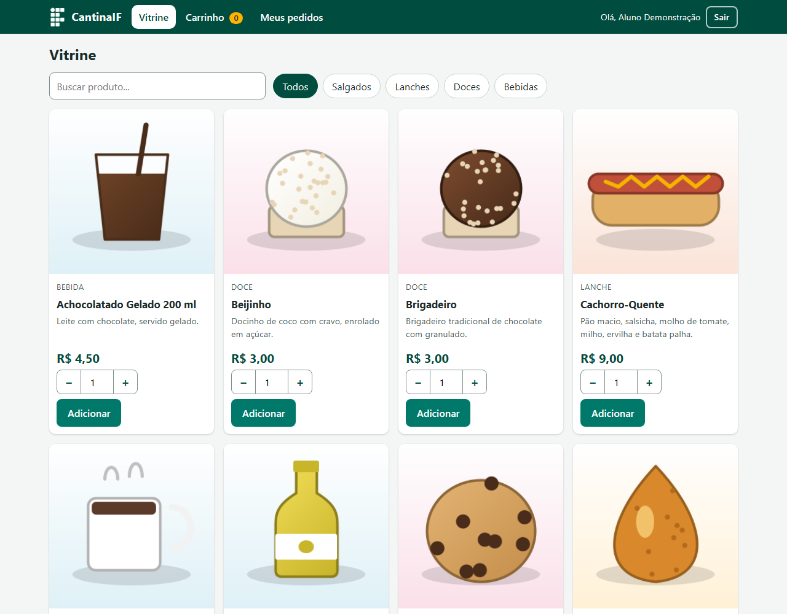
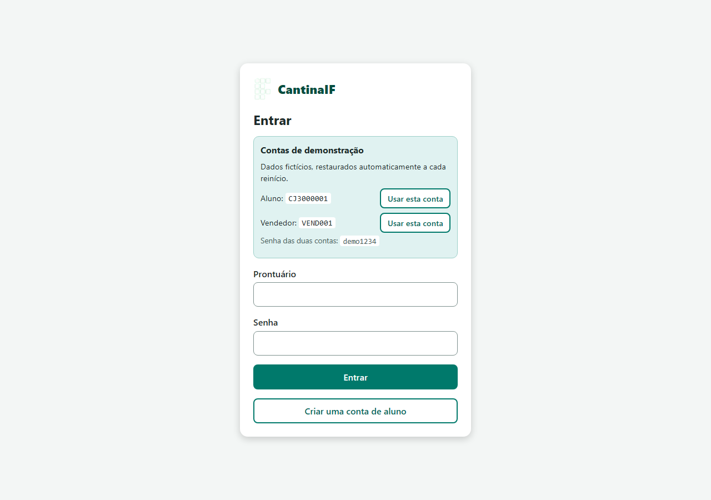
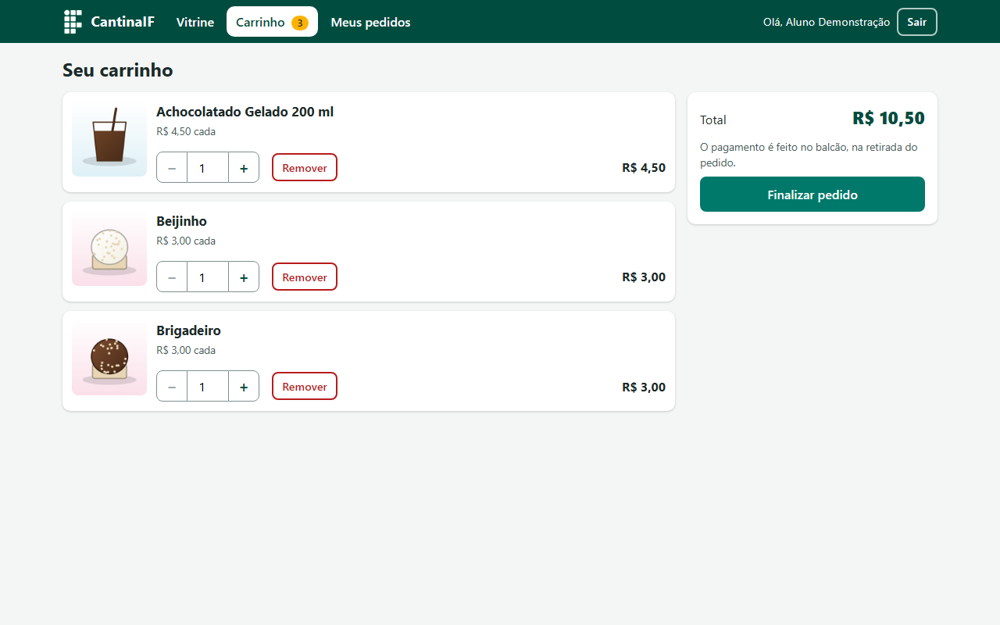
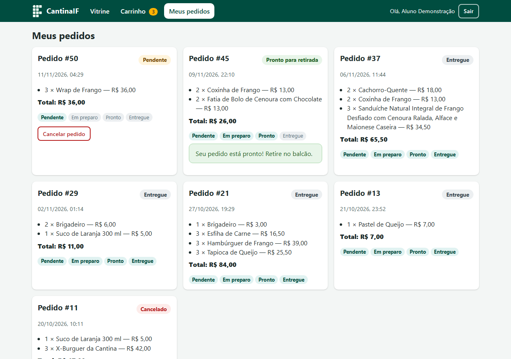
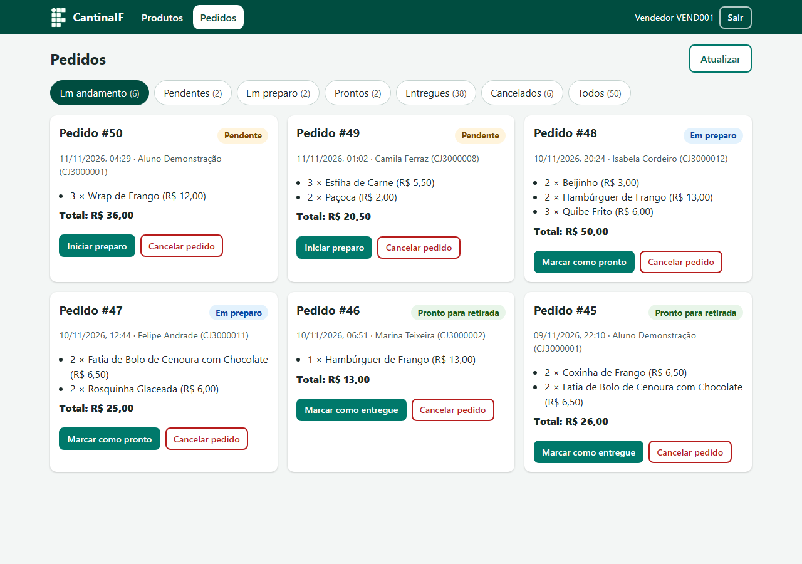
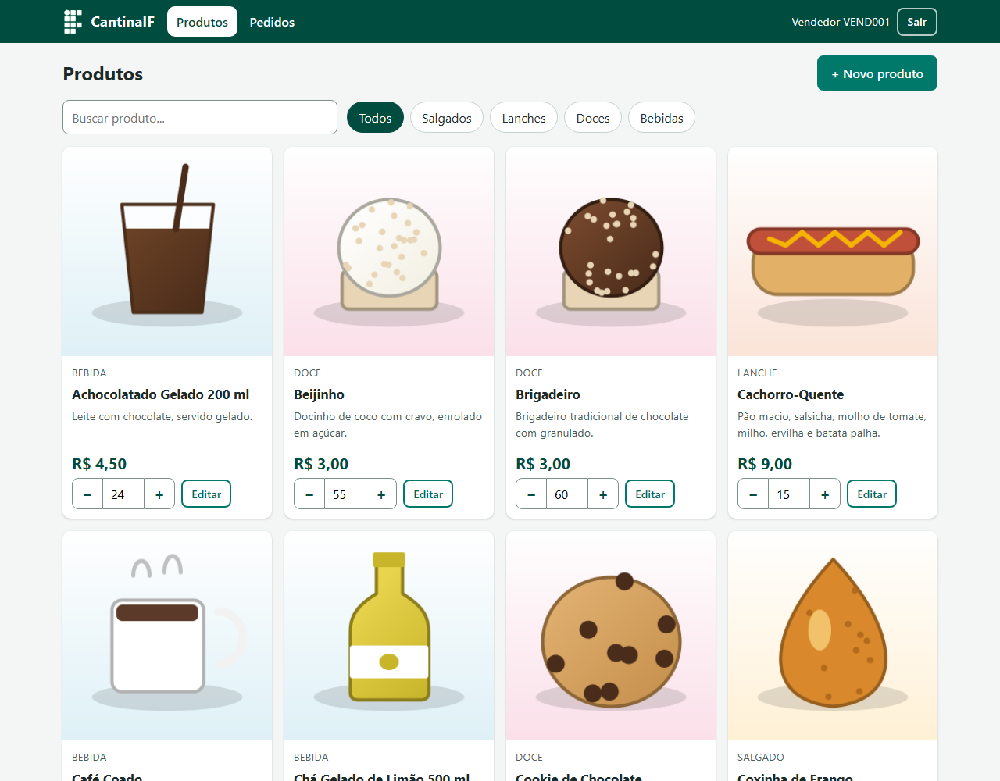
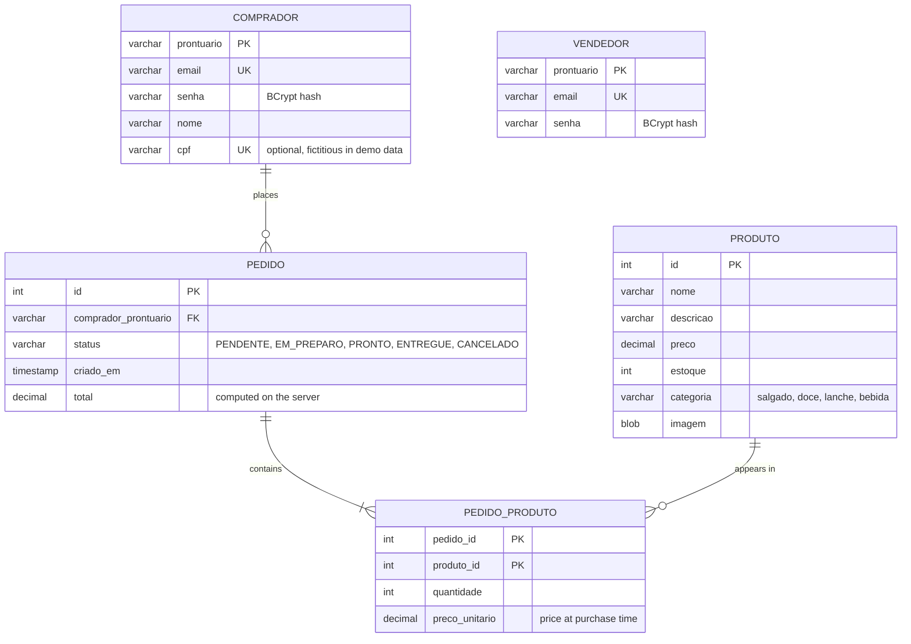

# CantinaIF

[](https://github.com/TiagoJSaraiva/CantinaIF/actions/workflows/ci.yml)

> Leia em português: [LEIA-ME.md](LEIA-ME.md)

Pre-ordering system for a school canteen at an IFSP campus (Instituto Federal de São Paulo): students browse the day's products on their phone, reserve items ahead of the break, and pick them up (and pay) at the counter; the canteen operator manages products, stock and orders.

Live demo: _pending deployment_ <!-- DEMO_URL -->



## Table of contents

1. [Overview](#overview)
2. [Features](#features)
3. [Demo accounts](#demo-accounts)
4. [Screenshots](#screenshots)
5. [Stack and architecture](#stack-and-architecture)
6. [Data model](#data-model)
7. [Prerequisites](#prerequisites)
8. [Running it](#running-it)
9. [Environment variables](#environment-variables)
10. [Demo data](#demo-data)
11. [Tests and CI](#tests-and-ci)
12. [Deploying to Render](#deploying-to-render)
13. [Security](#security)
14. [Implementation notes and known limitations](#implementation-notes-and-known-limitations)
15. [Credits](#credits)

## Overview

CantinaIF started as the final project of the *CJOWEB2* course (IFSP, Campos do Jordão campus, 2025). Canteens at federal institutes get crowded during breaks; with CantinaIF the student reserves the order during class and the seller starts preparing it early. It is **not** a delivery system and there is **no online payment**: payment happens at the counter when the order is picked up.

The project was later modernized (security, order domain, demo data, responsive UI, Docker, CI) while keeping the original technology choices: plain Servlets/JSP, JDBC, vanilla JavaScript, no frameworks.

## Features

**Student (buyer)**
- Sign up with institutional ID (*prontuário*), name, e-mail and password; login/logout.
- Storefront with text search and category filter (savory, snacks, sweets, drinks). Sold-out products are shown but cannot be bought; "last unit" badge when stock is 1.
- Cart with quantity change, item removal, subtotal and total (up to 99 units per item); stock is checked against what is already in the cart.
- Checkout creates the order and decrements stock in the same database transaction. If any item lacks stock, nothing is saved and the buyer is told which item. If a price changed since the item entered the cart, nothing is saved either: the cart is refreshed and the buyer must confirm again.
- "My orders": history with status, items, unit prices at purchase time and total.
- Cancel an order while it is still *Pending* (stock is returned).

**Seller (canteen operator)**
- Orders panel grouped/filterable by status (in progress, pending, preparing, ready, delivered, canceled) with counts and periodic refresh.
- Explicit status actions: *Pending → Preparing → Ready → Delivered*; cancel from any non-final status (returns stock). Invalid transitions are rejected by the server.
- Product management: create, edit (name, description, price, category, image), quick stock adjustment, search and category filter. Stock edits are compare-and-swap in SQL: if an order changed the stock in the meantime, the panel reports a conflict (HTTP 409) instead of overwriting it.
- Image upload (JPEG, PNG or GIF, up to 2 MB). Every image is decoded, resized (longest side 640 px) and re-encoded as JPEG (up to 150 KB, metadata stripped) on the server; files that cannot be decoded are rejected. WebP is not supported.

## Demo accounts

These are fictitious demo accounts, not secrets. They exist in demo mode (embedded H2 database) and are shown on the login page.

| Role | ID (*prontuário*) | Password |
|------|-------------------|----------|
| Student | `CJ3000001` | `demo1234` |
| Seller | `VEND001` | `demo1234` |

## The public demo: what to expect

If a public demo is deployed, keep in mind (all of this is by design, to keep a free, internet-facing demo safe and cheap):

- **Shared accounts with a public password.** Anyone can sign in as the demo student or the demo seller and create, edit or cancel anything. Do not type real personal data; everything is fictitious.
- **Limits** (defaults in demo mode, configurable, see the environment table): 60 products, 200 sign-ups, 100 open orders, 12 MB of images in total. When a limit is reached the app says so ("limite da demonstração atingido; a base é restaurada periodicamente"). There are also request-rate limits for write operations and for sign-ups and logins.
- **Periodic restore.** The database is in memory and goes back to the seed at every restart and every `CANTINA_DEMO_RESET_HOURS` hours (default 6). Anything created by visitors disappears.
- **Sessions at reset.** A session started before a restore is invalidated: the next click sends the user to the login page with the message "A demonstração foi restaurada; entre novamente." (an account created before the restore no longer exists).
- **Uploads are re-encoded** (JPEG, up to 640 px / 150 KB), so a visitor cannot fill the memory with large files.

## Screenshots

| Login | Storefront |
|---|---|
|  |  |
| **Cart** | **My orders** |
|  |  |
| **Seller: orders** | **Seller: products** |
|  |  |

Screenshots were captured from the running application (demo mode) in a headless Chrome at 1280 px width.

## Stack and architecture

- **Java 21**, **Jakarta Servlet 6 / JSP + JSTL 3**, WAR packaging, Tomcat 10.1+ (tested on 10.1.28).
- **JDBC** (no ORM) with a **HikariCP** pool, configured only through environment variables.
- **H2** (in-memory, MySQL mode) by default; **MySQL 8** when `CANTINA_DB_URL` is set. A single `db/schema.sql` works on both.
- **BCrypt** (`at.favre.lib:bcrypt`) for passwords, **Gson** for JSON, **JUnit 5** for tests, **Maven Wrapper** (Maven 3.9.11).
- Front end: JSP pages + vanilla JavaScript (`fetch`) + a single CSS file, mobile-first, no frameworks.

```
db/schema.sql                 database schema (MySQL 8 and H2)
src/main/java/
  dao/                        JDBC data access (users, products, orders) and business-rule exceptions
  model/                      domain objects, DTOs for JSON, order status enum
  seed/DemoDataSeeder.java    deterministic demo data (boot in H2, manual command elsewhere)
  servlets/                   controllers, JSON endpoints and the filters (see below)
  utils/                      Database (pool), config, BCrypt helper, login rate limiter, demo reset, image sniffing
src/main/resources/seed/img/  demo product illustrations (PNG)
src/main/webapp/              JSP pages, WEB-INF/jspf (head/navbar), css/app.css, js/, img/
src/test/java/                JUnit 5 tests (run on H2)
tools/GerarImagensSeed.java   generates the demo illustrations (Java2D)
docs/screenshots/             README screenshots
Dockerfile, docker-compose.yml, render.yaml, .env.example, .github/workflows/ci.yml
```

Request flow: `SecurityHeadersFilter` (CSP and friends) → `DbGateFilter` (read lock, so nobody sees the database in the middle of a demo restore) → `WriteRateFilter` (rate limit for write operations) → `AuthFilter` (role-based access: seller routes, buyer routes; also drops sessions from before a restore) → `CsrfFilter` (token on every state-changing request) → servlet → DAO → `Database` pool. Business rules (stock, status transitions) live in `PedidoDAO` inside transactions. JSON endpoints return DTOs (never raw entities or image bytes).

## Data model



`VENDEDOR` is standalone (there is a single canteen). Money is stored as `DECIMAL(10,2)` and handled as `BigDecimal`. CHECK constraints enforce non-negative price/stock/total, quantity ≥ 1, the category list and the status list.

## Prerequisites

- JDK 21 (`JAVA_HOME` set).
- To run the WAR without Docker: Tomcat 10.1+ (Jakarta namespace; Tomcat 9 does not work).
- Optional: Docker (image and `docker compose`), MySQL 8.
- Maven is not required: use the included wrapper (`./mvnw`, or `mvnw.cmd` on Windows).

## Running it

### Demo mode (no database)

```bash
./mvnw clean package
# copy target/CantinaIF-0.0.1-SNAPSHOT.war to Tomcat's webapps/ (as CantinaIF.war for /CantinaIF, or ROOT.war for /)
```

Start Tomcat and open `http://localhost:8080/CantinaIF/` (or `/`). With no `CANTINA_DB_URL`, the app uses an in-memory H2 database, creates the schema and loads the demo data at boot. The context path is dynamic: every URL in the pages is relative.

### Docker

```bash
docker build -t cantinaif .
docker run --rm -p 8080:8080 cantinaif
```

The image publishes the app at `/` (`ROOT.war`), honors the `PORT` variable, runs as a non-root user (`app`) and limits memory (`-XX:MaxRAMPercentage=60`, `-XX:MaxMetaspaceSize=192m`, `-XX:+ExitOnOutOfMemoryError`, so the platform restarts the service if memory runs out). At every start `docker-entrypoint.sh` edits Tomcat's `conf/server.xml` idempotently (port, `ErrorReportValve` without report/version and, only when `CANTINA_BEHIND_PROXY=true`, a `RemoteIpValve`); the proxy regex is never passed through `JAVA_OPTS`. The image was built and run locally (see [implementation notes](#implementation-notes-and-known-limitations)) and a CI job builds it and runs a smoke test on every push.

### With MySQL (`docker compose`)

```bash
cp .env.example .env     # set MYSQL_PASSWORD (required)
docker compose up --build
```

Compose starts MySQL 8.4 (schema applied from `db/schema.sql` on first start, data in a named volume) and the app, with `CANTINA_SEED_IF_EMPTY=true` so the demo data is loaded only if the database has no seller yet.

### Using an existing MySQL

Create the database (`CREATE DATABASE cantinaif CHARACTER SET utf8mb4 COLLATE utf8mb4_unicode_ci;`), apply `db/schema.sql`, and set `CANTINA_DB_URL`, `CANTINA_DB_USER` and `CANTINA_DB_PASSWORD` for Tomcat.

## Environment variables

| Variable | Default | Purpose |
|---|---|---|
| `CANTINA_DB_URL` | _(unset)_ | JDBC URL. Unset = embedded H2 in demo mode. |
| `CANTINA_DB_USER` / `CANTINA_DB_PASSWORD` | _(unset)_ | Database credentials (not needed for H2). |
| `CANTINA_SEED_IF_EMPTY` | `false` | `true` loads the demo data at boot if there is no seller (any database; deletes nothing). |
| `CANTINA_DEMO_RESET_HOURS` | `6` | Demo mode only: hours between automatic restores of the seed data (accepts fractions; `0` disables). |
| `CANTINA_SEED_CONFIRMAR` | _(unset)_ | `SIM` confirms the manual seed command (alternative to `--confirmar-apagar`). |
| `CANTINA_MAX_PRODUTOS` | `60` in demo mode, unlimited otherwise | Maximum number of products (`0` = no limit). |
| `CANTINA_MAX_COMPRADORES` | `200` in demo mode, unlimited otherwise | Maximum number of registered students. |
| `CANTINA_MAX_PEDIDOS_ABERTOS` | `100` in demo mode, unlimited otherwise | Maximum number of open orders (pending, preparing or ready). |
| `CANTINA_MAX_BYTES_IMAGENS` | `12582912` (12 MB) in demo mode, unlimited otherwise | Maximum total size of stored product images. |
| `CANTINA_COOKIE_SECURE` | `false` | `true` marks the session cookie `Secure` (use behind HTTPS). |
| `CANTINA_BEHIND_PROXY` | `false` | Docker image: `true` makes Tomcat trust `X-Forwarded-For`/`X-Forwarded-Proto` from trusted proxies. |
| `CANTINA_TRUSTED_PROXIES` | private ranges | Docker image: Java regex of trusted proxy IPs. |
| `PORT` | `8080` | Docker image: HTTP port. |
| `MYSQL_DATABASE`, `MYSQL_USER`, `MYSQL_PASSWORD` | `cantinaif`, `cantina`, _(required)_ | `docker compose` only. |

Variables can also be given as JVM system properties with the same name (e.g. `-DCANTINA_DEMO_RESET_HOURS=1`). No credential is stored in the code or in `context.xml`.

## Demo data

In demo mode the application boots populated, so there is always something to show. The seeder (`seed.DemoDataSeeder`) is deterministic (fixed seed `20260610`), and all dates are relative to the moment it runs, so the data never looks stale.

Contents:
- **30 products** (8 savory, 8 snacks, 7 sweets, 7 drinks) with realistic names, descriptions and prices in BRL. Edge cases: 3 sold-out products, 1 product with stock 1, 1 very long name, 1 product without an image.
- **Original illustrations** for 29 products (PNG, up to 30 KB each, versioned in `src/main/resources/seed/img/`; the seed loads them as they are, without the upload re-encoding). No photos or third-party artwork; brand names were avoided.
- **1 seller and 19 students** (the demo student, 15 with orders and 3 with none). Names are fictitious and e-mails use the `.demo` domain. CPF numbers are generated synthetically (they have valid check digits, but no relation to real people; any coincidence with a real number is accidental). The CPF is stored in a database column only and is not shown on any screen or returned by any API.
- **50 orders** over the last 30 days in every status, with totals consistent with unit prices; the demo student has a varied history. Stock follows the real rule (an order decrements stock when created, cancelling returns it): the stored stock is the final one and the seeder computes the initial stock as final + units in non-canceled orders, so no open order exceeds the initial stock.

All data is fictitious.

How it is restored:
- every restart of the application (the H2 database is in memory);
- periodically, every `CANTINA_DEMO_RESET_HOURS` hours (default 6). The restore is atomic: hashes and images are prepared first, then everything is deleted and reinserted in one transaction while requests wait on a lock; sessions from before the restore are invalidated;
- manually, against the configured database (this **deletes** products, buyers, sellers and orders):

```bash
CANTINA_DB_URL=jdbc:mysql://localhost:3306/cantinaif CANTINA_DB_USER=... CANTINA_DB_PASSWORD=... \
  ./mvnw -q compile exec:java -Dexec.args=--confirmar-apagar
```

Without `--confirmar-apagar` (or `CANTINA_SEED_CONFIRMAR=SIM`) the command only prints a warning and does nothing; without `CANTINA_DB_URL` it refuses to run.

Regenerating the images (JDK 21, from the repository root):

```bash
java tools/GerarImagensSeed.java src/main/resources/seed/img
```

## Tests and CI

```bash
./mvnw verify
```

88 JUnit 5 tests run on in-memory H2 (and Mockito for the filters): DAOs (users, sellers, products, orders), BCrypt, order domain (total computed on the server, stock decrement, insufficient stock with rollback, price change at checkout, cancellation returning stock, invalid status transitions, compare-and-swap stock edits), cart (overflow, concurrency), seed (running twice yields identical data; totals, stock and initial stock consistent; concurrent readers and checkouts during repeated restores never see an empty or inconsistent database), `AuthFilter` and `CsrfFilter`, login guard (per account and per IP), rate limiter, demo caps, image resizing and type detection, and sign-up validation.

GitHub Actions (`.github/workflows/ci.yml`) has two jobs on every push and pull request to `main`: `./mvnw -B verify` with JDK 21 (the WAR is stored as an artifact) and a Docker job that builds the image, runs it with `PORT=10000`, `CANTINA_BEHIND_PROXY=true` and a 512 MB limit, and runs `tools/smoke-proxy.sh` (health check, `Secure` cookie, HSTS, real client IP in the login limiter, error page without server details) plus a non-root check. `tools/test-entrypoint.sh` runs the real entrypoint against a local Tomcat 10.1 copy (no Docker needed). There are no automated browser tests.

## Deploying to Render

The repository includes a Render Blueprint (`render.yaml`): one Docker web service named `cantinaif`, plan `free`, health check at `/health` (public, lightweight, no login, no database), auto-deploy on, and these variables: `CANTINA_COOKIE_SECURE=true`, `CANTINA_DEMO_RESET_HOURS=6` and `CANTINA_BEHIND_PROXY=true`. `CANTINA_DB_URL` is intentionally not set, so the app runs in demo mode with H2.

1. Create an account at [render.com](https://render.com) and connect your GitHub account.
2. **New → Blueprint**, choose this repository and confirm. Render builds the Dockerfile and deploys.
3. When the deploy is live, open the service URL and sign in with the demo accounts.
4. Put the public address in the "Live demo" line at the top of this README.

Free plan caveats (stated honestly):
- the service **spins down after about 15 minutes without traffic** and takes **around 1 minute** to wake up on the next request;
- the file system is **ephemeral** and the database is in memory, so **data returns to the seed at every restart** (and every 6 hours while running);
- the free instance is small (512 MB); the image limits the Java heap accordingly.

Behind Render's HTTPS proxy: with `CANTINA_BEHIND_PROXY=true` the entrypoint adds Tomcat's `RemoteIpValve`, which honors `X-Forwarded-For` / `X-Forwarded-Proto` only when the connection comes from a trusted proxy address (private ranges by default; override with `CANTINA_TRUSTED_PROXIES`). Then `request.isSecure()` is true (so the session cookie is `Secure` and HSTS is sent) and the login limiter sees the real client IP.

What was actually tested: the image was built and run locally with Docker (`--memory=512m`, `PORT=10000`, `CANTINA_BEHIND_PROXY=true`, `CANTINA_COOKIE_SECURE=true`), and requests with simulated `X-Forwarded-*` headers from the Docker gateway (a private address) showed the `Secure` cookie, HSTS and per-client-IP login limiting; the entrypoint was also run against a local Tomcat 10.1.28. What was **not** tested: Render itself. Whether Render's edge addresses fall inside the default trusted ranges is unverified; if the cookie is not `Secure` or all visitors share one IP on Render, set `CANTINA_TRUSTED_PROXIES` accordingly.

## Security

- Passwords stored as BCrypt hashes; the session never holds a password; the session id is rotated on login; logout invalidates the session (POST + CSRF).
- Role-based access control in `AuthFilter` for pages and APIs (seller × buyer), 401/403 for APIs, redirect to login for pages.
- CSRF: per-session token required on every POST/PUT/DELETE (`X-CSRF-Token` header or `_csrf` field).
- Headers: strict Content-Security-Policy (no inline scripts or styles), `X-Frame-Options: DENY`, `X-Content-Type-Options: nosniff`, `Referrer-Policy`, `Permissions-Policy`, HSTS on HTTPS.
- Session cookie `HttpOnly` and `SameSite=Lax`, `Secure` when configured or when the request is HTTPS (as resolved by the server, not by a raw header). The CSRF token is renewed at login. Anonymous visitors only get a session on the login and sign-up pages, and it lasts 5 minutes; at most 5000 sessions are active at once and sessions are not persisted across restarts. A POST with the wrong role gets 403.
- Login rate limit in two layers: 5 failures per 3 minutes per account (prontuário) and a much higher ceiling of 40 failures per 5 minutes per client IP, so people behind one NAT are not locked out together. In demo mode the two demo accounts (public password) are exempt from the per-account lock (they remain under the per-IP ceiling). Known trade-off: someone can lock another person's account for a few minutes by failing on purpose. Write operations are also rate-limited per IP (90 per minute; 6 sign-ups per 10 minutes). All in memory, per instance.
- Uploads: size limit (2 MB), type detected from the magic bytes, then decoded, resized and re-encoded as JPEG (metadata dropped; very large pixel counts are rejected before decoding); served with `nosniff` and an `ETag`.
- Output escaping everywhere (`<c:out>`, `textContent`); prepared statements for all SQL; friendly error pages with no stack traces.

## Implementation notes and known limitations

- No online payment: the order is reserved and paid at the counter.
- Stock is decremented when the order is created and returned on cancellation (atomic `UPDATE ... WHERE estoque >= ?` inside the order transaction).
- The sign-up form asks for ID, name, e-mail and password. The CPF column exists but is only filled by the demo data. The original idea of validating IDs against the institution's records and supporting several campuses/canteens is **not implemented**: there is a single canteen.
- Docker was exercised locally (Docker 28): the image builds and runs as non-root with a 512 MB limit (about 150 MB at rest and about 200 MB after 30 uploads of 1.4 MB images, which were capped by the demo limits), and `docker compose` with MySQL 8.4 starts, loads the seed (`CANTINA_SEED_IF_EMPTY`), lets the seller sign in and creates products with the next id after the seed. It has not been run on Render. The seed's manual command (`exec:java`) was only run against H2 files; on MySQL it was exercised through the compose boot path.
- Databases created with the old schema need `ALTER TABLE` statements: add `Comprador.cpf VARCHAR(11) UNIQUE`; add `Pedido.status VARCHAR(12) NOT NULL DEFAULT 'PENDENTE'`, `Pedido.criado_em TIMESTAMP NOT NULL DEFAULT CURRENT_TIMESTAMP` and `Pedido.total DECIMAL(10,2) NOT NULL DEFAULT 0`; add `Pedido_Produto.preco_unitario DECIMAL(10,2) NOT NULL DEFAULT 0`. Old plain-text passwords are not valid BCrypt hashes, so those users must be re-created.
- The cart lives in the HTTP session (in memory); the login rate limiter is per instance; images are stored as BLOBs; lists are not paginated; the seller panel refreshes by polling.
- Dates are shown in the browser's time zone.

## Credits

Final project of the CJOWEB2 course, IFSP Campos do Jordão, 2025, by:

- Brian Gustavo de Oliveira Brandão
- Luiz Henrique Freitas
- Tiago Jarruge Saraiva
- Arthur de Almeida Brandino
